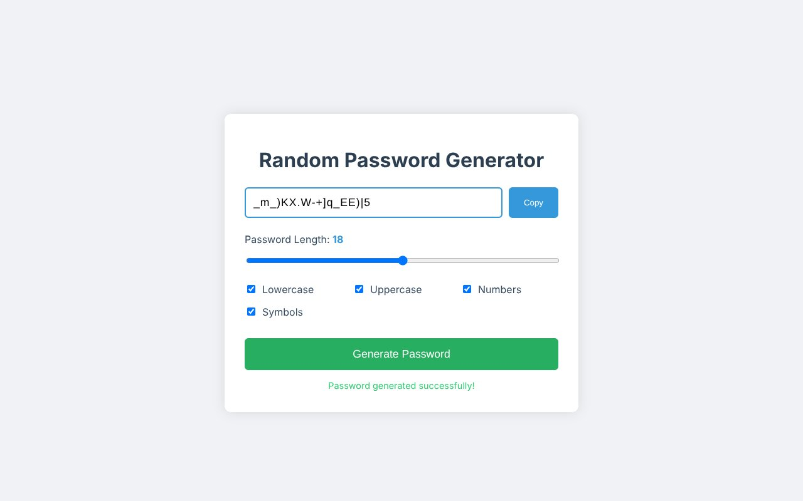
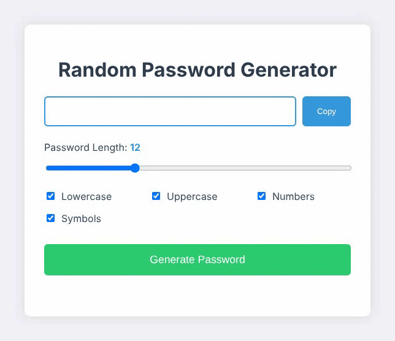

# Random Password Generator

Generate a random password from 4 to 32 characters, choosing lowercase, uppercase, numbers and symbols, then copy it with one click.

**Live:** https://3t3rn4tu5.github.io/RandomPasswordGenerator/

## Built with

Plain HTML, CSS and JavaScript.

## Run it locally

Open `index.html` in a browser.
